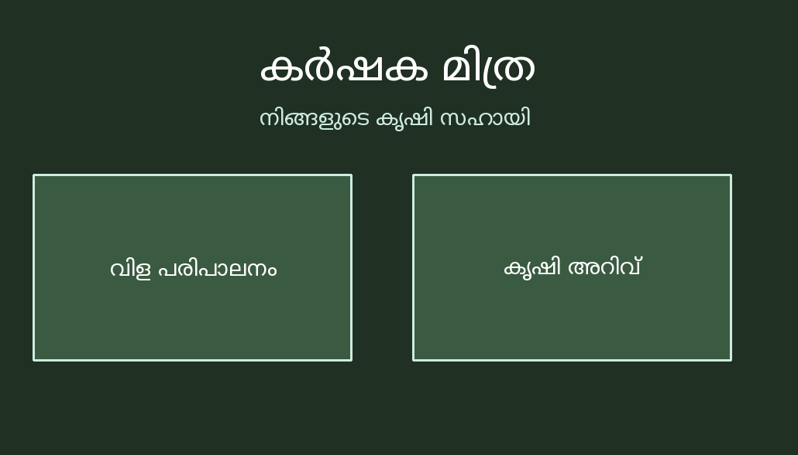

# SHN-MEDIAPIPE

#  [KARSHAKA MITRA]

  

# SHN-MEDIAPIPE

#  [KARSHAKA MITRA]

### 💡 What's the idea?
# 🌱 Karshaka Mitra

A gesture-controlled plant-care assistant built using Python, OpenCV, and MediaPipe. It uses hand gestures to navigate an interactive Malayalam interface that provides basic crop-care information and solutions for common plant problems.

### 🌐 Check it out
- **Live Website:** [ N/A]
- **GitHub Repo:** https://github.com/joannajijoy/SHN-MEDIAPIPE

### 🛠️ What did you use?
Python, OpenCV, MediaPipe and pillow

### 👥 The Humans Behind It
-Joanna Jijoy-joannajijoy

### ⚙️ Hardware Corner
 N/A

### 📸 Show Us What You Built!
### 📸 Screenshots

### 🎥 Demo Video

[Watch Karshaka Mitra Demo](videos/karshakamitra.webm)

### ✨ Cool Things It Does
Navigate the interface using hand gestures, without a mouse.
Explore crop-care information in Malayalam.
Learn about common plant problems and their possible solutions

**Built with curiosity at Saturday Hack Night 💜**# 🚀 KARSHAKA MITRA

